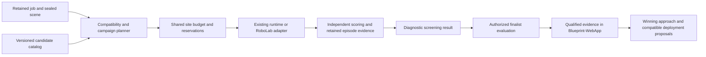

# Adaptable beta policy screening

Research and implementation specification, October 26, 2026. This continues the owner’s request to evaluate dozens of policies and APIs against each reconstructed job, with Blueprint-WebApp alongside the pipeline.

**Recommendation: extend RoboLab through thin adapters and keep Blueprint’s campaign orchestration, scoring, provenance, spending controls and website integration.** Register complete candidate configurations as data. A new checkpoint behind a verified interface should usually need configuration; a new robot, action representation or API protocol still needs an adapter and conformance checks.

This document completes the research/design stage. It does not claim that the many-candidate runner or Blueprint-finalist recommendation path is implemented. Public availability, existing adapter code, admission to a particular scene, and successful execution are different facts.

## Scope and recovered state

Beta journey: prepared job scene → candidate screening → qualified finalist evidence → supported delivery options. The observed blocker is that the existing internal policy route selects exactly two candidates, while the team route runs one admitted candidate with a team-specific scored protocol. Neither is a general per-site screening coordinator. The smallest coherent change is a catalog and coordinator over existing interfaces, followed by explicit Blueprint-run provenance in the existing website journey. Completion means a replayable campaign with arbitrary candidate count, bounded aggregate spending, exact scene/profile bindings and result ingestion that cannot promote screening into a recommendation.

Inspected pipeline main: `140cefe5699c1088d95bf92691ebfe7d4f5df640`; WebApp main: `a923a3461b3ca8dbae9ad29553e97135cb3f9b96`.

- [Website copy PR #1109](https://github.com/ognjhunt/Blueprint-WebApp/pull/1109) is open, unmerged and has no auto-merge setting. Its copy changes are separate from this runner design.
- [Owner decisions PR #2957](https://github.com/ognjhunt/BlueprintCapturePipeline/pull/2957) records Blueprint-operated candidates, $15 total screening budget per site, approximately ten episodes per candidate, per-site authorization for full finalist scoring, and owner-approved deployment-company contact. It also records that Blueprint’s own finalist scoring may support a recommended pilot.
- The deployed packet setup was inspected read-only: production release `eb72434ea`, watcher enabled, registry fingerprint and profile digest verified, downloaded inputs passed the compiler validators locally. No automatic packet compilation had occurred at inspection. The referenced runtime archive exists at its declared size; its full bytes were not downloaded/rehashed. Live ownership and service environment binding were not independently rechecked. Configuration validity is not a successful scene compile.
- The reusable ADP two-candidate protocol remains distinct. Per-site beta screening does not create a cross-site policy ranking or a physical-validation claim.

## Candidate support table

All ten named policy/API candidates were confirmed in primary sources. Effort estimates describe integration work after required access and rights, not elapsed-time commitments or model-quality rankings. Hardware figures are upstream documentation, not Blueprint measurements; simulation memory and runtime overhead are additional.

| Candidate | Published access and licensing | Runtime / resource evidence | Blueprint route and remaining work |
| --- | --- | --- | --- |
| **π0.5-DROID** | Public openpi checkpoint; Apache code, with applicable checkpoint/backbone terms retained. Blueprint records Gemma-related conditions. | Upstream openpi documents >8 GB inference memory; Blueprint’s admitted profile currently budgets 12 GB. | Existing pinned adapter and selectable internal candidate. Lowest integration effort for beta reuse, but no arbitrary new site is qualified by the registry entry alone. [openpi](https://github.com/Physical-Intelligence/openpi) |
| **GR00T N1.7 DROID** | Public checkpoint; checkpoint card specifies NVIDIA Open Model License. Gated Cosmos-Reason2 backbone access also matters. | Official minimum 16 GB+ VRAM; current Blueprint registry uses 24 GB. | Existing pinned adapter/selectable candidate; preserve exact image and state transforms. Lowest effort alongside π0.5. [Model card](https://huggingface.co/nvidia/GR00T-N1.7-DROID), [hardware](https://github.com/NVIDIA/Isaac-GR00T/blob/main/getting_started/hardware_recommendation.md) |
| **Cosmos3 Edge Policy DROID** | Public 4B checkpoint under OpenMDW1.1; model card permits commercial use. | Approximately 9 GB BF16 weights; NVIDIA reports chunk latency on Jetson AGX Thor. Weight size is not peak VRAM. | Existing Cosmos client/server code and upstream RoboLab integration; add exact beta catalog/profile and validate the site path. Good next adapter candidate; no quality advantage is established. [Card](https://huggingface.co/nvidia/Cosmos3-Edge-Policy-DROID), [deployment](https://developer.nvidia.com/blog/post-train-nvidia-cosmos-3-edge-for-on-device-robot-control/) |
| **Cosmos3 Nano Policy DROID** | Public 16B checkpoint, OpenMDW1.1 commercial/noncommercial use. | Documented workstation serving on RTX PRO 6000; optional multi-GPU configuration. | Similar interface to Edge, larger resource requirement; existing menu still lists integration blockers. Moderate work including third-camera support and byte-verified checkpoint admission. [Card](https://huggingface.co/nvidia/Cosmos3-Nano-Policy-DROID), [server](https://github.com/NVIDIA/cosmos-framework/blob/main/docs/action_policy_droid_server.md) |
| **MolmoAct2-DROID** | Public weights/server; Apache-2.0 statements coexist with research/education intended-use language. Blueprint currently keeps commercial review pending. | About 22 GB download; official FP32 DROID path reports ~88 GB usage/~96 GB free VRAM. BF16 minimum not established. | Moderate HTTP/processor integration. Verify exact robot/controller and license record; profile memory instead of treating the old 16 GB registry field as validated capacity. [Repository](https://github.com/allenai/molmoact2), [card](https://huggingface.co/allenai/MolmoAct2-DROID) |
| **FLUX 3 Action DROID** | Gated download; Apache code and FLUX Kommunity v1.0 weights have different terms. Qualifying commercial output use has a revenue condition and other restrictions, including model-improvement uses. | Upstream documents ~32 GB BF16 or 24 GB with FP8/offload. | Moderate technical effort with existing upstream RoboLab serving support. Keep license/access unresolved in Blueprint until its actual use is covered; do not infer permission from code licensing. [Card](https://huggingface.co/black-forest-labs/flux-3-action-droid), [weight license](https://huggingface.co/black-forest-labs/flux-3-action-droid/blob/main/LICENSE.md) |
| **DreamZero-DROID** | Public weights are CC-BY-NC-4.0; code is Apache-2.0. Commercial Blueprint use needs separate rights. | Official distributed instructions require at least two GPUs, tested on H100/GB200. | Moderate technical adapter effort, heavier serving and temporal state; commercial eligibility currently blocks scheduling. [Weights](https://huggingface.co/GEAR-Dreams/DreamZero-DROID), [runtime](https://github.com/dreamzero0/dreamzero) |
| **OpenWAM-α** | Foundation and embodiment-specific checkpoints exist; official FR3 checkpoint and code are Apache-2.0, subject to component terms. | Training guidance is not inference sizing. Minimum inference VRAM and exact FR3 rate remain unverified. | Moderate/high effort. Choose a released embodiment checkpoint and inspect its packaged configuration; the foundation model is not a universal DROID policy. [Project](https://github.com/OpenWAM-Official/OpenWAM), [FR3 checkpoint](https://huggingface.co/OpenWAM/OpenWAM-Alpha-Real-Single-Arm-Franka) |
| **Dream Labs Dream-1** | Hosted API and public SDK; SDK Apache license does not settle hosted terms. Account/model version and data-use terms remain unverified. | Vendor-hosted inference; launch advertises pricing from $3/hour, not a complete campaign quote. | An adapter already exists in Blueprint, but no verified account/site execution is established. Requires a matching bimanual rig and session/history behavior. Higher scene effort than DROID. [Launch](https://dreamlabs.ai/research/dream-1/), [SDK](https://github.com/dreamlabs-co/dreamlabs) |
| **Physical Intelligence Pi API** | Official beta launched October 13; batch onboarding. Account access and commercial/data terms were not established. | Hosted training/inference; no public universal camera/action/rate contract verified. | Reserve a catalog entry with explicit unknown fields. Integrate after account-specific contract is available. Openpi access does not grant Pi API access. [Launch](https://www.pi.website/blog/api-beta), [access](https://www.pi.website/waitlist) |

Primary-source links above describe upstream releases. Blueprint readiness is based on the inspected code and retained evidence, not those release announcements.

## Scene requirements are configuration-specific

Keep one immutable job scene with metric transforms, appearance, collision, task objects and success contract. Compose that scene with versioned robot/camera/controller profiles. Reuse source assets, but rerun relevant placement, visibility, collision and observation checks for each changed profile. The current stable packet profile is a DROID baseline, not a profile for all candidates.

Image dimensions below are **height × width**, except explicitly stated SDK width × height. Rendering dimensions and policy input dimensions are separate fields.

| Policy profile | Camera and image contract | Control, action and lifecycle contract |
| --- | --- | --- |
| π0.5-DROID | Exterior + wrist, padded/resized to 224×224. | Current RoboLab uses absolute joint-position/gripper actions, 15-step chunks and 15 Hz. Preserve Blueprint’s pinned absolute-joint contract; an older upstream example describes velocity and ten steps. [Transform](https://github.com/Physical-Intelligence/openpi/blob/main/src/openpi/policies/droid_policy.py), [RoboLab client](https://github.com/NVlabs/RoboLab/blob/main/policies/pi0_family/client.py) |
| GR00T N1.7 DROID | Exterior-left + wrist, 180×320 uint8 without padding. | Joint7 + gripper1 and transformed EEF state; validated wrapper executes eight actions per query. Separate GR00T/ZMQ environment. [Validated integration](https://github.com/NVIDIA/Isaac-GR00T/blob/main/examples/RoboLab/README.md) |
| Cosmos Nano/Edge DROID | Wrist + two exterior views, packed as 540×640 RGB. | Eight-dimensional absolute-joint/gripper output, 32-step chunks; 15 Hz defaults. Edge has structured prompt formatting. Isolate sessions per environment/episode. [Client](https://github.com/NVlabs/RoboLab/blob/main/policies/cosmos3/client.py), [server](https://github.com/NVIDIA/cosmos-framework/blob/main/cosmos_framework/scripts/action_policy_server_robolab.py) |
| FLUX DROID | Three RGB views, each 360×640; native tensor/preprocessing contract differs from Cosmos. | 32 absolute-joint actions at 15 Hz; explicit gripper normalization. Native and LeRobot processor paths must not double-apply conversions. [Contract](https://huggingface.co/black-forest-labs/flux-3-action-droid#observation-and-action-contract) |
| MolmoAct2 DROID | Exterior + wrist; official simulation renders 360×640, with checkpoint processor handling internal shape. | Eight-dimensional state and absolute joint-pose output via HTTP. Official simulator uses FR3 + Robotiq 2F-85: verify kinematics before using a Panda profile. Rate remains to be pinned. [Server](https://github.com/allenai/molmoact2/blob/main/examples/droid/host_server_droid.py), [robot](https://github.com/allenai/molmoact2/blob/main/sim_eval/robots/franka_droid.py) |
| DreamZero DROID | Exterior-left + wrist, 180×320; current baseline uses a black additional exterior slot. | Eight-dimensional joint-position output, 24-action horizon; reset temporal history. Do not turn the black slot into a new camera silently. [Client](https://github.com/NVlabs/RoboLab/blob/main/policies/dreamzero/client.py) |
| OpenWAM-α | Head and optional wrist slots depend on checkpoint; PNG/WebSocket protocol. | Config-bound normalization, state/action ordering and temporal stride. FR3 gripper/rate/image details still need exact artifact inspection. [Integration](https://github.com/OpenWAM-Official/OpenWAM/blob/main/assets/openwam_usage_docs/benchmark-integration.md) |
| Dream-1 | Overhead + left/right wrist, SDK default **320 width ×176 height** JPEG; nine history frames at 5 Hz. | Bimanual parallel grippers; SDK defaults 20 Hz pacing and 48-step chunks. Blueprint’s existing adapter bridges 20 Hz policy actions to 60 Hz native control with a three-tick hold. Joint or EEF/IK path depends on embodiment; real rig/access/integration still need verification. [Client contract](https://github.com/dreamlabs-co/dreamlabs/blob/main/dream_library/dream_client/README.md) |
| Pi API | Unknown until provider supplies the account/model interface. | Never inherit openpi assumptions from the provider name. [Launch](https://www.pi.website/blog/api-beta) |

RoboLab’s DROID baseline is Franka Panda + Robotiq 2F-85 with 120 Hz physics and decimation eight. Camera poses are calibrated robot/environment transforms, not interchangeable labels. Different embodiments compare complete approaches on the same job objective; they do not constitute an isolated policy-only comparison. [Robot](https://github.com/NVlabs/RoboLab/blob/main/robolab/robots/droid.py), [timing](https://github.com/NVlabs/RoboLab/blob/main/robolab/registrations/droid/auto_env_registrations_jointpos.py).

## Why the hybrid route

RoboLab explicitly supports external registration of custom robots, observations, actions and simulation settings. Its policy client boundary handles server inference and episode resets. Blueprint can own its extension package without maintaining a fork. RoboLab’s guide also says it has no central policy registry; that missing orchestration is precisely the layer Blueprint needs. [Registration](https://github.com/NVlabs/RoboLab/blob/main/docs/environment_registration.md), [policy extension](https://github.com/NVlabs/RoboLab/blob/main/docs/policy.md).

RoboLab supplies useful execution machinery, but importing reconstructed USD is only part of site adaptation. Blueprint must bind stable task-object identities, metric registration, collisions, resets, variations and job-specific success predicates, then translate independent episode results into its evidence contracts. Ordinary recorded video does not replace Blueprint’s exact lossless policy-input frames and digest manifests. [Scene definitions](https://github.com/NVlabs/RoboLab/blob/main/docs/scene.md), [task definitions](https://github.com/NVlabs/RoboLab/blob/main/docs/task.md).

## Minimum configurable contract

This is a proposed design, not a second production registry already in use. Reuse current validation and digest helpers. A catalog entry describes a configuration; eligibility is computed from independently checked artifacts, not trusted from a `runnable: true` label.

| Contract group | Required data |
| --- | --- |
| Identity | Stable candidate ID; catalog revision; checkpoint revision and verified bytes, or provider model/deployment identity with mutability recorded; normalization and adapter digests. |
| Robot and sensing | Robot asset and kinematics digest, gripper, joint order/limits, base frame, camera extrinsics/intrinsics, source resolution, preprocessing, frame history and reset behavior. |
| Policy interface | Implemented adapter ID, transport, instruction schema, state layout, action units/frame/rotation convention, gripper direction/range, control Hz, prediction horizon and executed horizon. |
| Execution | Admitted runtime/image revision, simulator version, co-resident resource requirements, endpoint/credential reference, task kinds actually supported, conformance/canary evidence. |
| Eligibility | Checkpoint/component license record, account access, hosted disclosure/data-use constraints, site compatibility results and explicit unavailable reasons. |
| Cost | Dated price basis, startup/storage/transfer/compute/API bounds, deadline, teardown and maximum reserved cost. Unknown costs remain unknown. |

No fixed candidate-count limit is needed. A 40-candidate manifest should use the same planner as a two-candidate manifest. New checkpoints on an existing verified interface are data changes; new protocols or physical semantics require a narrow implementation and tests.

## Scheduling and evidence

1. Resolve the scene and catalog once into an immutable campaign. Every considered candidate receives a status: compatible, unavailable, deferred for budget, executed, failed, or interrupted, with a reason. No unsupported candidate disappears from the record.
2. Freeze common screening conditions and seeds where comparisons are valid. Render the admitted observation profile for each candidate and record every transformation. Keep hidden finalist conditions separate from screening; tune neither prompts nor scoring against held-out outcomes.
3. Reserve cost against the **whole site’s $15** allowance before launch, including outstanding reservations. Startup, retention, inference, retries and teardown belong in the bound. Reuse existing allocator/ledger/watchdog infrastructure; catalog cardinality is not spending permission.
4. Use existing durable intent/outbox/lease patterns. Campaign, candidate revision and condition identity must prevent duplicate work after restarts. Reconcile ambiguous provider timeouts before retrying paid execution. An infrastructure void is separate from a task failure.
5. Publish diagnostic screening with scope, uncertainty, actual coverage and failure reasons. Ten episodes are a triage signal, not recommendation evidence. No model or predicted WAM video grades its own performance.
6. Full finalist scoring uses per-site owner authorization and its own frozen protocol. Only complete, qualified, independently scored results can support a recommendation.

Budget example, not a cost estimate: 30 candidates ×10 episodes means 300 episodes. A $15 cap leaves an average of $0.05 per episode **including all overhead**. Expensive candidates will require selective scheduling, warm-worker reuse or explicit deferral. Dozens registered cannot honestly promise dozens fully run for $15.

## Blueprint-WebApp integration

The current legacy recommendation path conflates the run operator with the deployment team: `EvalRunRecord.teamId` feeds recommendation attribution and supply-agreement matching. Removing that identity check would weaken the delivery linkage. A fake “Blueprint robot team” would preserve the wrong data model.

Prefer the newer job-managed path: `server/utils/jobManagedEvaluation.ts` already binds current brief/capture/task provenance, and the job marketplace supports `managed_run` evidence references and separate delivery proposals. Add a qualified finalist projection there, preserving the current diagnostic projection’s inability to declare a winner. The existing one-team booking path can remain a compatibility reader until a deliberate migration is needed.

The cross-repo result must freeze:

- `evaluationPurpose`: screening or finalist;
- `executionOperator`: Blueprint or external operator, independent of deployment provider;
- `approachId` and complete candidate configuration digest, including robot/tool/cameras/controller;
- job, brief, capture, scene, success-contract and scenario-plan identities;
- runtime/admission identity, per-episode accounting, simulator scoring provenance, retained-media references and result digest;
- qualification, robot-free probe, frozen job thresholds, observed metrics and limitations.

Deployment companies belong on separate reviewed compatibility/proposal records bound to that approach/configuration and agreed scope. A high score neither proves a company’s ability to deliver nor authorizes contact. Preserve current supply agreements, consent, revision checks and owner-approved contact.

**Correction to the handoff:** both current repositories implement **200 planned episode rows, at most ten infrastructure voids, and at least 190 nonvoid scored episodes**. The pass mark defaults to 90%; it is not automatically a 90% lower confidence bound. Current checks also bind scene qualification, current job/capture, exact accounting and cycle-time targets where present. Changing operator provenance should preserve this protocol. If the literal requirement becomes 200 valid nonvoid scores, introduce a separately versioned protocol with explicit replacement/void accounting; do not silently rewrite historical evidence.

## Build order and acceptance

| Increment | Reused implementation | Completion evidence |
| --- | --- | --- |
| Catalog and dry planner | `task_evaluation_policy_candidate_registry.py` metadata, `policy_interface_binding.py`, `team_embodiment.py`, scene packet compiler | 40+ candidates resolve deterministically; duplicate IDs, incompatible profiles, unknown costs and unverified artifacts cannot become runnable; existing ADP pair tests unchanged. |
| Beta campaign execution | Existing single-candidate episode clients, `team_evaluation_plan.py` variation machinery, canonical allocator and durable progression | Explicit Blueprint screening admission; aggregate reservations cannot exceed cap; restart/timeout cases cannot double-launch; actual ten-episode purpose distinct from scored-200. Do not loosen team guards globally. |
| RoboLab scene bridge | Existing pinned runtime plus external registration, scene/task definitions and policy clients | One existing compatible DROID candidate passes retained-observation replay and a bounded site smoke; matched second candidate proves configuration switching. Every new profile repeats affected checks. |
| Qualified finalist publication | Pipeline result scoring/qualification, WebApp managed-run projection, existing evidence predicates | Screening, development fixtures, stale captures, invalid runtime, failed robot-free probe and bad episode accounting all rejected; qualified Blueprint finalist accepted with operator separate from proposed deployers. |
| Additional candidates | Existing interfaces first; then Cosmos, Molmo/FLUX when ready; separate bimanual/hosted profiles | License/access, exact checkpoint/contract, resources, profile compatibility and observed canary evidence recorded per configuration. No eligibility inferred from a marketing name. |

Run focused schema/catalog/planner and cross-repo evidence tests. Actual worker/client/bundle changes additionally require the repository’s lifecycle rehearsal and provider import-closure suites before any paid attempt. A complete free replay and resource preflight precede the first capped live test.

The code correction accompanying this research only replaces the stale claim that Dream’s API adapter is missing. The adapter exists; Dream remains unavailable pending access, terms, matching runtime and integration evidence. No many-candidate runner, finalist publishing route or new policy execution is claimed by that correction.
